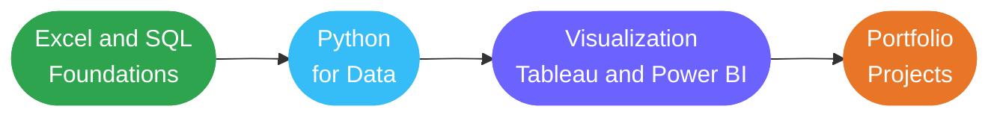

<!-- Header -->

  

<!-- Animated greeting -->

  

<!-- Animated role -->

  

<h2 align="center"> About Me</h2>

  <i>A student with a growing passion for data and technology, 
  learning how data can uncover insights and support better decisions.</i>

-  Currently pursuing my studies
-  Interested in data analytics and data-driven insights
-  Learning Python (Pandas, NumPy, Matplotlib, Seaborn), SQL, and Excel
-  Exploring data visualization with Tableau and Power BI
-  Curious about how data can solve real-world problems
-  Building my knowledge through learning and hands-on projects

<h2 align="center"> Tech Stack &amp; Tools</h2>

<b>PROGRAMMING &amp; LIBRARIES</b>

  
  &nbsp;&nbsp;&nbsp;&nbsp;
  
  &nbsp;&nbsp;&nbsp;&nbsp;
  
  &nbsp;&nbsp;&nbsp;&nbsp;
  
  &nbsp;&nbsp;&nbsp;&nbsp;
  

<b>NOTEBOOKS &amp; ENVIRONMENTS</b>

  
  &nbsp;&nbsp;&nbsp;&nbsp;
  

<b>DATABASES</b>

  
  &nbsp;&nbsp;&nbsp;&nbsp;
  

<b>ANALYSIS &amp; VISUALIZATION</b>

  
  &nbsp;&nbsp;&nbsp;&nbsp;
  
  &nbsp;&nbsp;&nbsp;&nbsp;
  

<h2 align="center"> Learning Roadmap</h2>

<h2 align="center"> Goals</h2>

-  Strengthen my foundation in data analysis
-  Improve my Python programming skills
-  Learn to work with databases using SQL (MySQL &amp; PostgreSQL)
-  Explore data visualization and storytelling with Tableau and Power BI
-  Build personal projects to apply what I learn
-  Keep learning, growing, and improving every day

<h2 align="center"> My Mindset</h2>

  <b><i>"Every expert was once a beginner."</i></b>

  Learning is a continuous process. Every small project, every mistake, 
  and every new concept is a step toward becoming better.

  <i>Thanks for stopping by my profile!</i>

